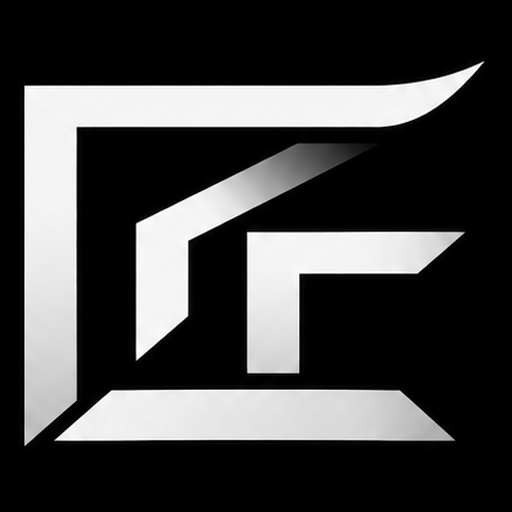
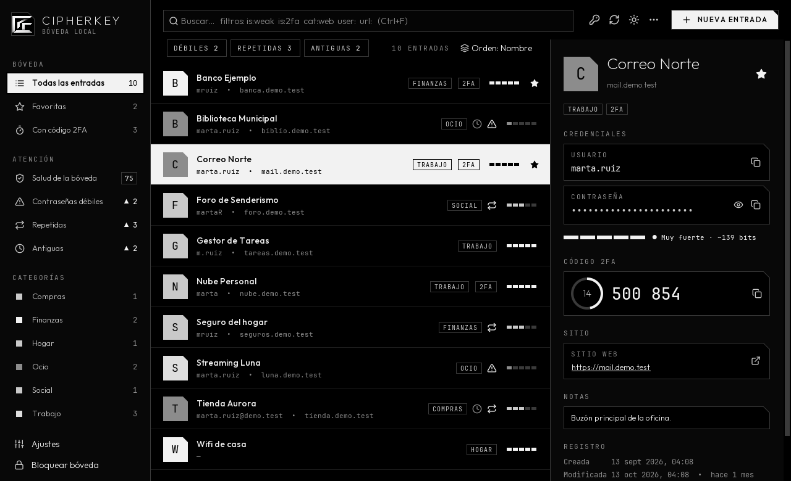
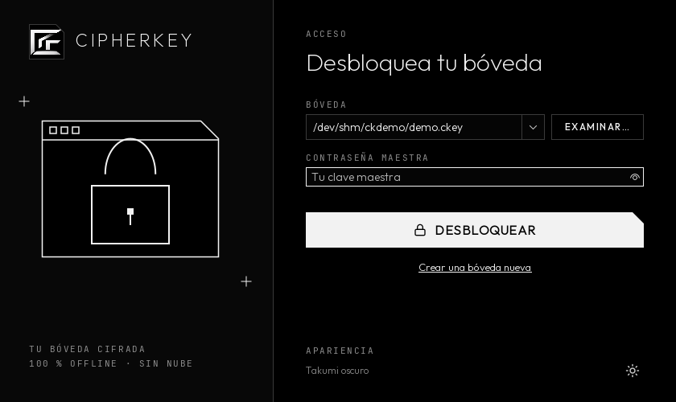
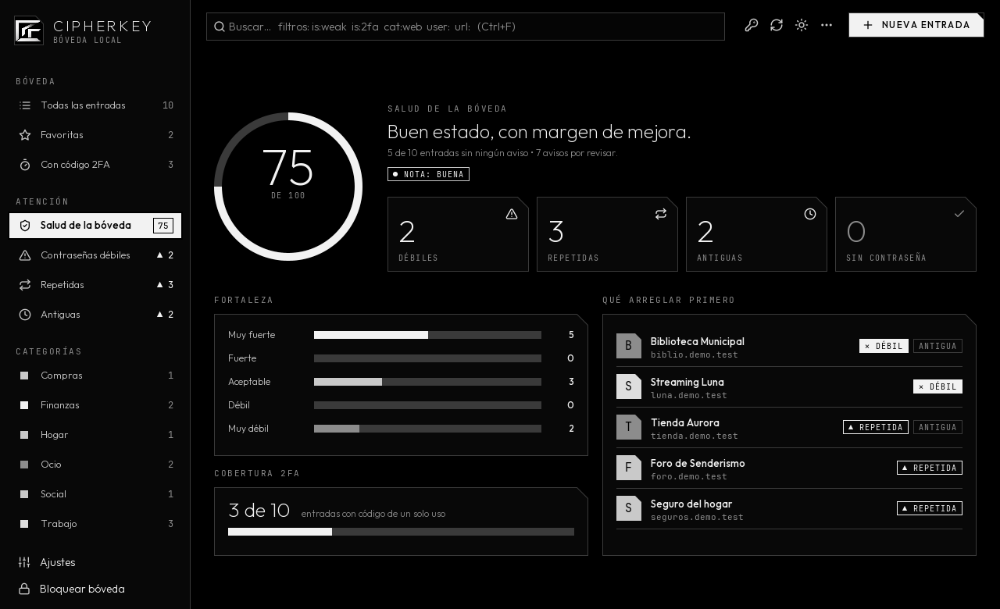
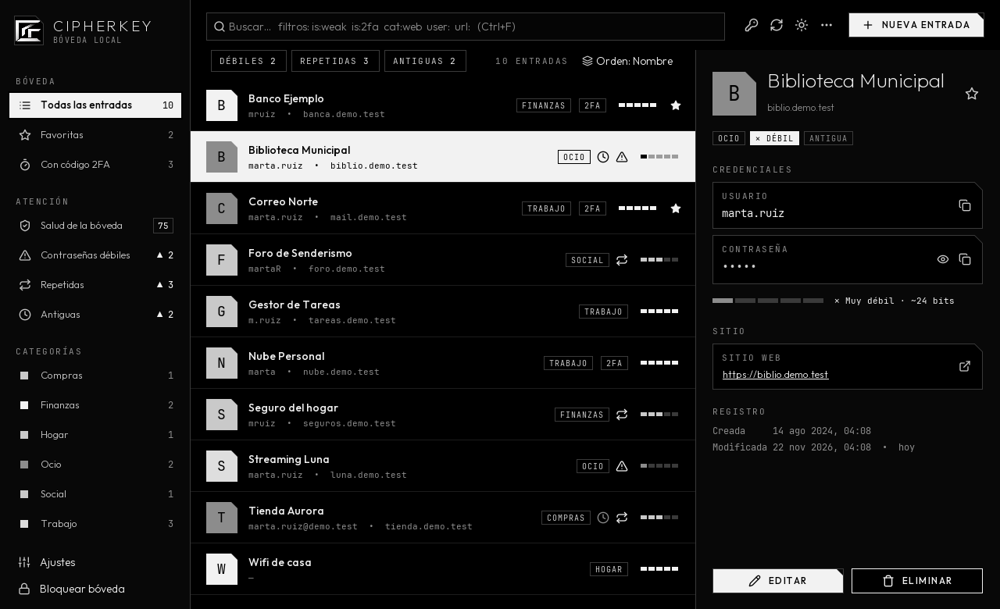
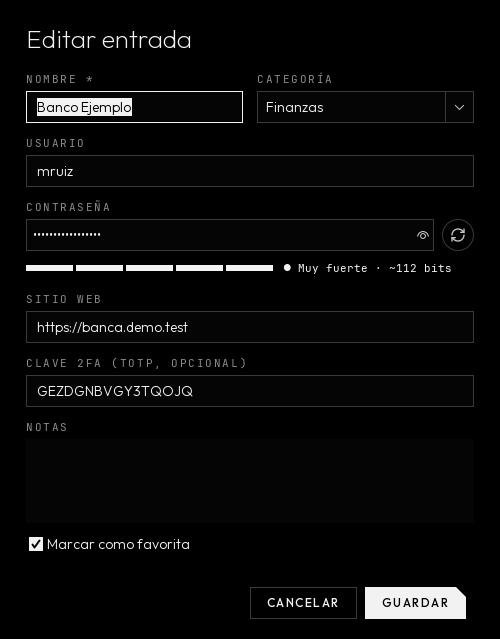
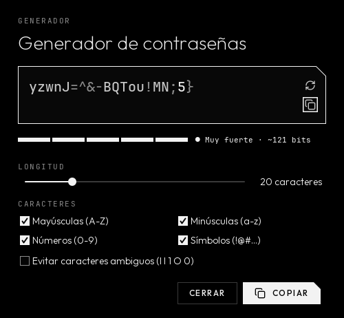
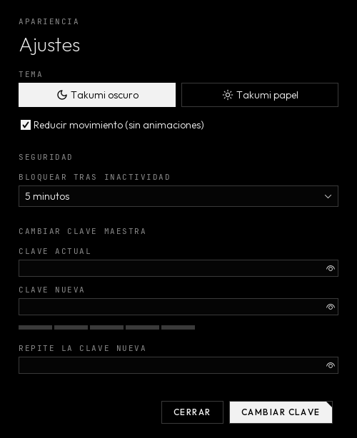
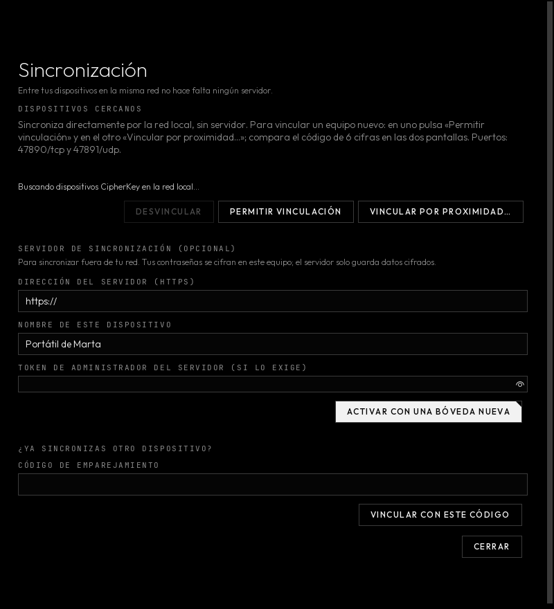
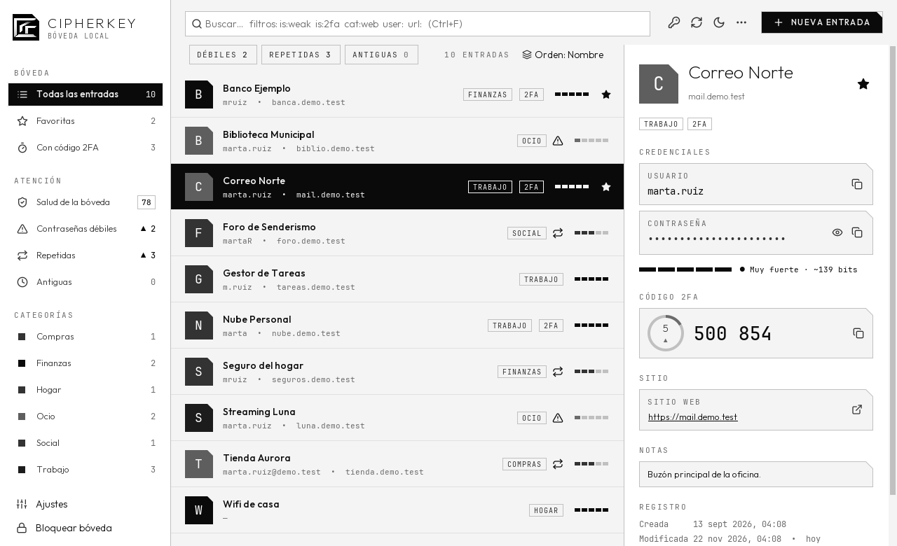

<p align="center">
  
</p>

<h1 align="center">CIPHERKEY</h1>

<p align="center">
  Gestor de contraseñas de escritorio, cifrado y 100 % local, en Java y Swing.<br>
  Un único fichero <code>.ckey</code>, sin cuentas ni servidores.
</p>

<p align="center">
  
  
  
  
</p>

<p align="center">
  
</p>

> Las capturas son de la aplicación real en ejecución con una bóveda de demostración de datos inventados
> (se generan con [`tools/Capturas.java`](tools/Capturas.java)).

---

## Índice

- [Características](#características)
- [Capturas](#capturas)
- [Instalación](#instalación)
- [Seguridad](#seguridad)
- [Sincronización en proximidad](#sincronización-en-proximidad-misma-red-sin-servidor)
- [Compilar y probar](#compilar-y-probar)
- [Estructura](#estructura)
- [Identidad visual](#identidad-visual)
- [Versionado](#versionado)
- [Estado y límites conocidos](#estado-y-límites-conocidos)
- [Licencia](#licencia)

---

## Características

- Bóveda cifrada en un único archivo `.ckey` protegida con clave maestra.
- Entradas con usuario, contraseña, sitio web, notas, **categorías** y **favoritas**; búsqueda instantánea por nombre, usuario, sitio, categoría o notas.
- Generador de contraseñas (8 a 64 caracteres, sin caracteres ambiguos opcional) y medidor de fuerza.
- **Códigos 2FA (TOTP)** por entrada, compatibles con Google Authenticator/Aegis, con cuenta atrás.
- **Salud de la bóveda**: puntuación de 0 a 100, contraseñas débiles, repetidas, antiguas o vacías, cobertura de 2FA y qué arreglar primero.
- **Historial** de las últimas 10 contraseñas de cada entrada.
- **Importar** CSV de Bitwarden, Chrome/Edge/Firefox y KeePass; exportar a CSV.
- **Copia de seguridad** de la bóveda (sigue cifrada).
- Portapapeles que se borra solo a los 30 s y bloqueo automático por inactividad (configurable).
- Tema **Takumi oscuro** (por defecto) y **Takumi papel** (claro); la elección se recuerda. Atajos de teclado y menú contextual.
- Sincronización entre tus dispositivos por la red local, sin servidor (ver más abajo).
- 100 % offline: no hace conexiones a internet; solo habla con otros dispositivos de tu red local o con el servidor opcional que tú configures.

## Capturas

| Acceso | Salud de la bóveda |
|---|---|
|  |  |
| **Detalle de una entrada** | **Editar entrada** |
|  |  |
| **Generador de contraseñas** | **Ajustes** |
|  |  |
| **Sincronización** | **Variante papel (clara)** |
|  |  |

Más variantes en [`docs/capturas/`](docs/capturas): `acceso-papel.png` y `salud-papel.png`.

### Atajos

| Atajo | Acción |
|-------|--------|
| `Ctrl+N` | Nueva entrada |
| `Ctrl+F` | Buscar |
| `Ctrl+B` / `Ctrl+U` | Copiar contraseña / usuario |
| `Ctrl+E` | Editar |
| `Supr` | Eliminar (con la lista enfocada) |
| `Ctrl+L` | Bloquear |
| `Ctrl+Mayús+S` | Sincronización y dispositivos cercanos |

## Instalación

Descarga la última versión desde **[Releases](https://github.com/Takumi-Organization/cipherkey-desktop/releases/latest)**.
Cada versión trae el JAR ejecutable y los paquetes que se hayan podido generar para ella, con su suma SHA-256
(`<fichero>.sha256`; comprueba con `sha256sum -c <fichero>.sha256`).

| Archivo | Cómo usarlo |
|---------|-------------|
| `cipherkey-<versión>.jar` | Requiere **Java 25**: `java -jar cipherkey-<versión>.jar` |
| `CipherKey-<versión>-linux-x64.tar.gz` | Linux x64, **incluye su propio Java**: `tar xzf …` y ejecuta `CipherKey/bin/CipherKey` |

Los instaladores `.deb`, `.rpm`, `.msi` y `.dmg` los puede generar [`packaging/package.sh`](packaging/package.sh) en el sistema
correspondiente (o el flujo de GitHub Actions `Release`), pero **no forman parte de la release 4.2.0** (ver «Estado y límites»).
Los paquetes no están firmados.

La primera vez: pulsa **Crear una bóveda nueva**, elige dónde guardar el `.ckey` y define tu clave maestra (mínimo 8 caracteres;
si la olvidas, no hay recuperación).

## Seguridad

| Característica | Implementación |
|---------------|---------------|
| Derivación de clave | Argon2id (64 MiB, 3 iteraciones, sal de 32 bytes); parámetros guardados en la cabecera |
| Cifrado | AES-256-GCM, nonce aleatorio nuevo en cada guardado |
| Integridad | La cabecera del fichero se autentica como AAD: cualquier alteración invalida la bóveda |
| Guardado | Atómico (fichero temporal + `fsync` + renombrado) con copia `.bak` de la versión anterior |
| Memoria | La contraseña maestra no se conserva tras abrir; solo la clave derivada, que se pone a cero al bloquear |
| Portapapeles | Se limpia a los 30 s si sigue conteniendo lo copiado |
| Bloqueo | Por inactividad (5 min por defecto) |

- No se almacenan contraseñas en texto plano y la clave maestra nunca se guarda.
- El límite de intentos del acceso es solo de usabilidad: quien tenga el `.ckey` puede atacarlo offline, por eso la protección real es
  Argon2id + una clave maestra larga.
- Doble factor de la bóveda: pendiente. Los códigos TOTP de las entradas son otra cosa: sirven para tus cuentas, no para abrir CipherKey.
- Formato `.ckey` v3 con módulo `core` compartido con la app móvil; migración automática desde v2 con copia `.v2.bak`.

## Sincronización en proximidad (misma red, sin servidor)

Sincroniza el escritorio y el móvil directamente por la red local, **sin servidor ni internet y sin configurar nada**. Diseño en
[docs/adr/0002-proximidad-sin-servidor.md](docs/adr/0002-proximidad-sin-servidor.md) (canal y descubrimiento en
[0001](docs/adr/0001-sincronizacion-en-proximidad.md)). Arranca al **desbloquear** la bóveda y se para al bloquearla.

**Cómo vincular dos dispositivos** (botón de sincronización de la barra o `Ctrl+Mayús+S` → «Dispositivos cercanos»):

1. En un dispositivo pulsa **Permitir vinculación** (120 s, un dispositivo).
2. En el otro pulsa **Vincular por proximidad…** (si está en la misma red aparece en la lista; si no, escribe `IP:puerto`).
3. Aparece un **código de 6 dígitos** en las dos pantallas: compáralos y pulsa «Coincide» en ambas.
4. La primera vez se muestra un **resumen** que hay que confirmar en ambos; antes se hace una copia de seguridad
   `<bóveda>.bak-proximidad-<fecha>` junto a la bóveda.

- **Sin grupo ni servidor:** cada dispositivo tiene su identidad (Ed25519) dentro de su bóveda cifrada; la confianza es la clave
  del otro **fijada tras confirmar el código**. Si esa clave cambia, se aborta. «Desvincular» corta la sincronización.
- **Canal seguro:** X25519 efímero + HKDF, AES-256-GCM con contador estricto, firma Ed25519 sobre el transcripto y código con compromiso.
- **Fusión:** la primera vez entre dos bóvedas distintas es una **unión segura**: nunca se sustituye ni se borra una entrada; el mismo
  identificador con contenido distinto queda como conflicto para elegir. Después, fusión a tres bandas por par.
- **Puertos:** `47890/tcp` y `47891/udp` (abrir en el cortafuegos). Descubrimiento por balizas UDP multidifusión; si la red las
  bloquea, se conecta por `IP:puerto`.
- **Servidor (opcional y aparte):** el emparejamiento con servidor sigue disponible en la misma ventana, pero no es necesario.

## Compilar y probar

Requisitos: **JDK 25** y **Maven 3.9+**.

```bash
git clone https://github.com/Takumi-Organization/cipherkey-desktop.git
cd cipherkey-desktop
mvn test                     # 90 pruebas (JUnit 6)
mvn clean package            # genera target/cipherkey-<versión>.jar (JAR sombreado ejecutable)
java -jar target/cipherkey-*.jar
```

Paquete portable con Java incluido (necesita `jpackage` del JDK 25 en el `PATH`):

```bash
packaging/package.sh app-image   # carpeta portable en target/dist/, cualquier SO
packaging/package.sh deb         # Linux (requiere dpkg-deb/fakeroot)
packaging/package.sh rpm         # Linux (requiere rpmbuild)
packaging/package.sh msi         # Windows (requiere WiX Toolset)
packaging/package.sh dmg         # macOS
```

### Regenerar las capturas

`tools/Capturas.java` abre la aplicación real con una bóveda de demostración (datos inventados) y pinta cada ventana en un PNG
con `Component.paint`, sin ocupar el escritorio. Necesita un servidor X (por ejemplo `xvfb-run`, o Xwayland sobre un weston
headless) y un `user.home` temporal para no tocar las preferencias del usuario; la cabecera del fichero explica el comando.

## Estructura

```
src/main/java/dev/
 ├── controller/    lógica de la bóveda y de las entradas
 ├── model/         entradas, historial y consultas de búsqueda
 ├── persistence/   formato .ckey (Vault), CSV y preferencias
 ├── security/      generador, fuerza, TOTP, auditoría y salud
 ├── sync/          sincronización (proximidad y servidor opcional)
 └── view/          interfaz Swing con FlatLaf y tema Takumi
core/               formato, criptografía, fusión y sincronización (compartido con la app móvil)
packaging/          package.sh (jpackage) e iconos
docs/               decisiones de diseño (adr), capturas y marca
tools/              generador de capturas
web/                web estática de presentación (sin compilar)
```

## Identidad visual

La interfaz sigue la identidad **Takumi** ([takumi-design](https://github.com/Takumi-Organization/takumi-design)):

- Papel negro `#000` y tinta `#F2F2F2` (variante papel: `#F4F4F4` / `#0A0A0A`); **monocromo estricto**: sin color de acento,
  degradados, cristal ni sombras.
- Radio 0 con la **esquina superior derecha cortada en diagonal** (10 / 14 / 22 px).
- Seleccionado y botón primario por **inversión** (fondo tinta, texto fondo). El estado nunca va solo en color: glifo y texto
  (`●` correcto, `▲` aviso, `✕` error).
- Tipografía **Outfit** (200 en títulos, 300 en el cuerpo, 500 en énfasis) y **JetBrains Mono** (datos y etiquetas), embebidas
  en `src/main/resources/fonts/` con sus licencias SIL OFL 1.1 (`LICENSE-Outfit-OFL.txt`, `LICENSE-JetBrainsMono-OFL.txt`).
  Java2D no maneja ejes variables, por lo que Outfit viaja como tres instancias estáticas generadas de la fuente variable oficial.
- Todo el tema vive en `dev.view.Palette` (tokens), `dev.view.ThemeManager` (colores de FlatLaf) y
  `dev/view/themes/FlatLaf.properties` (estructura); el corte de esquina está en `dev.view.Draw` y `dev.view.TakumiButtonUI`.
  `PaletteTest` comprueba el contraste (≥ 4,5:1) y que ningún color de la paleta tiene saturación.

## Versionado

### 4.2.0 — Identidad Takumi (actual)

- Interfaz rediseñada con la identidad Takumi: dos variantes (oscuro y papel) que sustituyen a los temas con acento anteriores;
  desaparece el selector de acento (las preferencias antiguas se ignoran y se conserva la elección claro/oscuro).
- Tipografías Outfit y JetBrains Mono; iconos de ventana, instaladores y «Acerca de» con la marca Takumi.
- Estados con glifo y texto (nunca solo color); gráficos de salud en grises.
- La vista «Salud de la bóveda» ocupa todo el ancho de la ventana.
- Web de presentación rediseñada y estática; capturas nuevas y reproducibles.

### 4.1.x — Ryoku Glass · 4.0.0 — Interfaz con FlatLaf, formato `.ckey` v2, TOTP, auditoría, importación y exportación CSV, paquetes nativos

Antes: v3.0 (doble factor por email, eliminado), v2.0 (gestión de bóvedas y modo oscuro), v1.0 (generador y persistencia cifrada).

## Estado y límites conocidos

- **Release 4.2.0:** JAR sombreado y paquete portable de Linux x64 (con Java incluido). **No** se generaron `.deb`/`.rpm` (faltan
  `dpkg-deb` y `rpmbuild` en el equipo de publicación) ni los paquetes de Windows y macOS; el flujo `Release` de GitHub Actions
  puede construirlos, pero no se ha ejecutado.
- La interfaz solo se ha comprobado en Linux (Xwayland sobre X11 con OpenJDK 25). El renderizado en Windows y macOS no está verificado.
- Las capturas pintan el contenido de cada ventana sin la barra de título del sistema.
- No verificado: sincronización real escritorio ↔ móvil físico con bóvedas reales; descubrimiento multicast entre dos máquinas
  reales; Wi-Fi con aislamiento de clientes. La revocación es local (desvincular en cada dispositivo) y un vínculo da acceso a toda la bóveda.
- Doble factor de la propia bóveda (archivo de clave o FIDO2): pendiente. Escanear el QR del 2FA desde una imagen: pendiente.

## Licencia

[MIT](LICENSE) © 2026 AdriLabTech. Las tipografías Outfit y JetBrains Mono se distribuyen bajo SIL Open Font License 1.1
(ver `src/main/resources/fonts/` y `web/fonts/`). La marca Takumi pertenece a Takumi-Organization.

<p align="center"><sub>Web y capturas: Takumi-Organization</sub></p>
